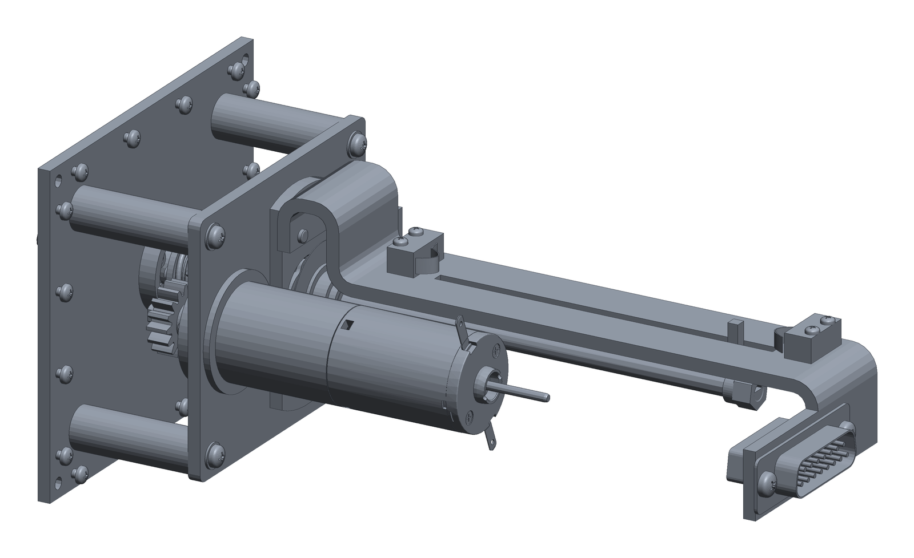
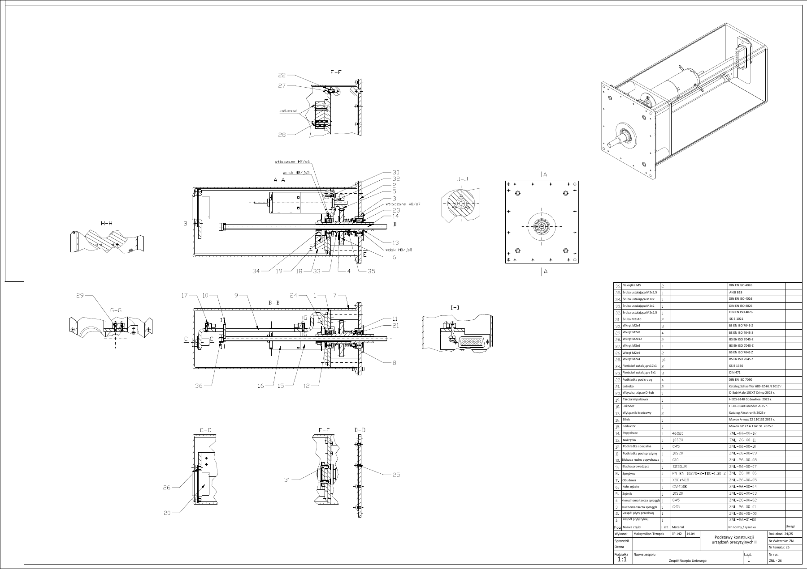

# Zespół napędu liniowego

Projekt konstrukcyjny precyzyjnego napędu liniowego z silnikiem DC, przekładnią zębatą i ciernym sprzęgłem przeciążeniowym: od założeń i obliczeń, przez model 3D w Autodesk Inventorze, po kompletną dokumentację rysunkową.

**Politechnika Warszawska** · Podstawy Konstrukcji Urządzeń Precyzyjnych · temat ZN-26 · 2024/2025



> Model 3D do obracania w przeglądarce: [model/zespol_napedu_liniowego.stl](model/zespol_napedu_liniowego.stl)

## Założenia

| Parametr | Wartość |
|---|---|
| Skok popychacza | 80 mm |
| Robocze obciążenie osiowe | 95 N, bez uszkodzeń przy 3× przeciążeniu |
| Prędkość przesuwu | 2 mm/s |
| Rozdzielczość pomiaru położenia | ≤ 1 µm |
| Napęd | silnik DC, zasilanie ≤ 24 V |
| Stopień ochrony | IP52 |
| Trwałość | ≥ 10 lat pracy ciągłej |
| Produkcja | seryjna |

Dodatkowo: elektryczne i mechaniczne ograniczenie położeń krańcowych, mocowanie kołnierzowe, złącze wielostykowe na szkielecie.

## Zasada działania

```
silnik DC + reduktor → zębnik (z₁ = 16) → koło zębate (z₂ = 40) → sprzęgło cierne → nakrętka → popychacz
```

Zębnik na wale reduktora napędza koło zębate, które przez cierne sprzęgło przeciążeniowe obraca nakrętkę ułożyskowaną w dwóch łożyskach kulkowych. Obrót nakrętki zamienia się na ruch liniowy popychacza. Gdy popychacz zostanie zablokowany, sprzęgło się ślizga i nadmierny moment nie trafia na konstrukcję.

Położenie popychacza mierzy enkoder optyczny z tarczą impulsową. Położenia krańcowe zabezpieczają dwa wyłączniki krańcowe oraz mechaniczna blokada ruchu popychacza. Sygnały wychodzą przez złącze D-Sub 15.

**Komponenty katalogowe:** silnik Maxon A-max 22 · reduktor Maxon GP 22 A · enkoder HEDL-9040 z tarczą HEDS-6140 · łożyska Schaeffler 689-2Z-HLN · wyłączniki krańcowe · złącze D-Sub 15

## Kluczowe obliczenia i decyzje

| Element | Wynik | Uzasadnienie |
|---|---|---|
| Przekładnia sprzęgająca | m = 0,9 mm, z₁ = 16, z₂ = 40, i = 2,5 | rozstaw osi 25,2 mm, powyżej minimum 24,7 mm wynikającego z kolizji reduktora z tarczą impulsową |
| Korekcja zazębienia | typu P-0, x = 0,06 | z₁ = 16 jest poniżej granicznej liczby zębów (17) |
| Materiały kół | zębnik: stal 10S20, koło: mosiądz CW450K | moduł wymagany z warunku na zginanie: 0,28 i 0,34 mm, czyli z zapasem względem 0,9 mm |
| Szerokość wieńców | b₁ = 5 mm, b₂ = 4 mm | maksymalne naciski powierzchniowe ≤ 210 MPa |
| Łożyska nakrętki | kulkowe 689-2Z-HLN (Schaeffler) | trwałość ok. 21 lat pracy ciągłej przy wymaganych 10; nośność spoczynkowa 730 N przy wymaganych 285 N (3× przeciążenie) |
| Sprzęgło przeciążeniowe | moment 108,4 mNm, siła docisku 28,9 N | 2 pary powierzchni trących, μ = 0,15 |
| Sprężyna sprzęgła | drut Ø1,30 mm, D = 15 mm, 5 zwojów (3 czynne), L₀ = 17 mm | średnica drutu znormalizowana wg PN-EN 10270-1 |

Pełne obliczenia (21 stron): [docs/obliczenia.pdf](docs/obliczenia.pdf)

## Dokumentacja rysunkowa

[](rysunki/01_rysunek_zlozeniowy.pdf)

| Rysunek | Format | Podziałka | Materiał |
|---|---|---|---|
| [Rysunek złożeniowy](rysunki/01_rysunek_zlozeniowy.pdf) (36 pozycji) | A1 | 1:1 | — |
| [Zespół płyty czołowej](rysunki/02_zespol_plyty_czolowej.pdf) | A3 | 1:1 | — |
| [Nakrętka](rysunki/03_nakretka.pdf) | A4 | 2:1 | 10S20 |
| [Płyta silnikowa](rysunki/04_plyta_silnikowa.pdf) | A4 | 1:1 | C45 |
| [Tuleja łożyskowa przednia](rysunki/05_tuleja_lozyskowa_przednia.pdf) | A4 | 5:1 | 10S20 |
| [Słupek dystansowy](rysunki/06_slupek.pdf) | A4 | 2:1 | 10S20 |

## Struktura repozytorium

```
├── README.md
├── renders/      podgląd złożenia i rysunku złożeniowego (PNG)
├── rysunki/      rysunek złożeniowy i rysunki wykonawcze (PDF)
├── model/        model złożenia w STL (podgląd 3D w przeglądarce)
├── docs/         obliczenia projektowe (PDF)
└── inventor/     pliki źródłowe Autodesk Inventor
    ├── zlozeniowka.iam                  złożenie główne
    ├── kola_zebate.iam                  przekładnia sprzęgająca
    ├── zespol_plyty_przedniej.iam       podzespół płyty czołowej
    ├── zespol_silnik_i_reduktor.iam     silnik z reduktorem
    └── *.ipt                            części
```

Żeby otworzyć projekt w Inventorze, otwórz `inventor/zlozeniowka.iam`. Wszystkie części leżą w tym samym folderze co złożenia, więc odwołania między plikami się nie gubią.

## Autor

Maksymilian Trzopek · Automatyka, Robotyka i Informatyka Przemysłowa, Politechnika Warszawska
